# Ultimo-MARL: High-Throughput Multi-Agent Reinforcement Learning & Resilient Live Inference

[](https://www.python.org/downloads/)
[](https://pytorch.org/)
[](https://pettingzoo.farama.org/)
[](https://github.com/astral-sh/ruff)
[](https://mypy-lang.org/)
[](https://github.com/StanislawGolec/Ultimo-MARL)
[](LICENSE)

A high-performance **Multi-Agent Reinforcement Learning (MARL)** engine and production **Live TCP Inference Client** for the imperfect-information card game *Ultimo* (enhanced Uno variant with card chaining, color declaration, tactical action defending, and special penalty mechanics).

---

## Key Achievements & Engineering Highlights

- **Ultra-High Simulation Throughput:** Sustains **>110,000 steps/second** in a pure headless Python simulator via bitmask operations, zero-allocation pre-allocated arrays, and multi-deck scaling (up to 216 cards for 16-player tables).
- **Sub-Millisecond Neural Inference:** CPU forward-pass latency of **~0.25 ms per step** (<0.3 ms SLA), enabling ultra-responsive real-time decision-making over live network connections.
- **16-Player Scalability & 90-Dim Fog of War Observation:** Accommodates up to 16 seats ($15$ padded opponent profile slots) while strictly concealing private opponent cards and draw deck contents.
- **Tactical Action Defending & Stacking:** Supports Skip deflection (`SKIP` deflecting to next player without skipping defender) and accumulating Draw Two / Wild Draw Four penalties (+2/+4) with strict $-\infty$ ($10^9$) logit masking.
- **Last-Man-Standing PettingZoo AEC Loop:** Simulation continues until only 1 player remains holding cards, utilizing tiered podium reward shaping (+1.0 for 1st down to -1.0 for loser).
- **Adversarial ULTIMO Policy:** Autonomous shout declaration when holding $\le 2$ cards and reactive 6-card penalty catches when opponents hold 1 card without declaring.
- **Production TCP Bot with 120-Second Reconnection Resilience:** Asynchronous event-driven client with line-delimited wire codec, room discovery (`LIST_ROOMS`, `CREATE_ROOM`), password access codes, credential caching, and snapshot state rehydration tested against **Go-Chaos-Proxy** network chaos.
- **Model Interoperability:** Export pipelines for both **TorchScript** (`.ptc`) and **ONNX** (`.onnx`) formats with dynamic batching support for C++ and TensorRT deployment.

---

## System Architecture

```mermaid
flowchart TD
    subgraph Offline_Self_Play ["Offline Self-Play Training Loop"]
        HeadlessSim["Headless Ultimo Simulator<br/>(16 Players, Multi-Deck 216 Cards, >110k steps/sec)"]
        AECEnv["PettingZoo AEC Environment<br/>(90-dim Fog of War Obs, Podium Rewards)"]
        ActionMask["Action Mask Filter<br/>(Tactical Defense Masking: Skip & Draw Stack)"]
        
        HeadlessSim --> AECEnv
        AECEnv --> ActionMask
        
        ActionMask --> DuelingDQN["Dueling Q-Network<br/>(Value + Advantage Streams, 90-dim Input)"]
        DuelingDQN --> MaskedQ["Masked Q-Values<br/>(-1e9 Logit Suppression)"]
        
        MaskedQ --> ReplayBuffer["Prioritized Replay Buffer<br/>(O(log N) Sum-Tree PER)"]
        ReplayBuffer --> Learner["Double DQN Learner<br/>(Huber Loss + Polyak / Hard Target Updates)"]
        Learner -.->|Model Weights| DuelingDQN
        
        Learner --> League["League Pool<br/>(70% Latest / 20% Historical / 10% Heuristic)"]
        League -.->|Opponent Policies| AECEnv
    end

    subgraph Production_Deployment ["Production Live TCP Inference"]
        LoomServer["Ultimo Game Server<br/>(Java 21 Virtual Threads)"]
        ChaosProxy["Go-Chaos-Proxy<br/>(Fault Injection & Latency Jitter)"]
        TcpClient["TcpGameClient<br/>(120s Reconnect Grace Window & Credential Cache)"]
        Codec["ProtocolCodec<br/>(Line-delimited ASCII Wire Events)"]
        LiveState["LiveGameState<br/>(Snapshot Rehydration & Defense Tracking)"]
        LiveBot["LiveBot Controller<br/>(Adversarial ULTIMO Shout/Catch & Spectator Mode)"]
        ExportedNet["TorchScript / ONNX Policy<br/>(<0.3ms Inference Latency)"]
        
        LoomServer <-->|Raw TCP| ChaosProxy
        ChaosProxy <-->|Raw TCP| TcpClient
        TcpClient <--> Codec
        Codec --> LiveState
        LiveState --> LiveBot
        LiveBot --> ExportedNet
        ExportedNet --> LiveBot
        LiveBot --> Codec
    end
```



---

## Mathematical Formalization

### 1. Expanded Observation Space ($\mathcal{S} \in [0.0, 1.0]^{90}$)
The environment exposes a normalized $90$-dimensional feature vector maintaining strict imperfect information (Fog of War) across up to 16 seats:

$$\mathcal{S} = \big[ \mathbf{s}_{\text{top}} \,\|\, \mathbf{s}_{\text{hand}} \,\|\, \mathbf{s}_{\text{opponents}} \,\|\, \mathbf{s}_{\text{dynamics}} \big]$$

| Feature Component | Slices | Dimensions | Description |
| :--- | :---: | :---: | :--- |
| **Top Card State** | $[0 : 18]$ | $18$ | One-hot card color ($4$), one-hot card value ($13$), and active wild indicator ($1$). |
| **Personal Hand Histogram** | $[18 : 72]$ | $54$ | Frequency vector of standard cards ($4 \text{ colors} \times 13 \text{ values} = 52$ normalized by $2.0$) and wild counts ($2$ slots normalized by $4.0$). |
| **Opponent Profiles** | $[72 : 87]$ | $15$ | Relative hand sizes for up to 15 opponents normalized by $10.0$ ($\min(\text{count}/10.0, 1.0)$), padded with $0.0$ for absent players. |
| **Game & Defense Dynamics** | $[87 : 90]$ | $3$ | Turn direction scalar ($+1.0/-1.0$), pending Skip deflection flag ($1.0/0.0$), and pending draw penalty normalized by $16.0$ ($\text{accumulated}/16.0$). |

### 2. Action Space Mapping ($\mathcal{A} = \{0, \dots, 60\}$)
The action space spans $61$ discrete options:
- **Actions $0 - 51$ ($52$ total):** Direct plays of standard color cards ($4 \text{ colors} \times 13 \text{ values}$).
- **Actions $52 - 55$ ($4$ total):** Wild card plays with declared target color ($\text{Wild} \to \text{Red, Blue, Green, Yellow}$).
- **Actions $56 - 59$ ($4$ total):** Wild Draw Four plays with declared target color ($\text{Wild Draw 4} \to \text{Red, Blue, Green, Yellow}$).
- **Action $60$ ($1$ total):** Draw card from deck or pass turn.

### 3. Strict Action Masking Invariants Under Defense
Let $M(s, a) \in \{0, 1\}$ be the binary legal action mask:

$$\tilde{Q}(s, a) = Q(s, a) \cdot M(s, a) - 10^9 \cdot (1 - M(s, a))$$

1. **Skip Deflection Masking Rule:**
   $$\text{If } \text{pending\_skip\_deflection} = 1: \quad M(s, a) = 1 \iff a \in \mathcal{A}_{\text{SKIP}} \lor a = \text{ACTION\_DRAW}$$
2. **Draw Stacking Masking Rule:**
   $$\text{If } \text{pending\_draw\_penalty} > 0: \quad M(s, a) = 1 \iff a \in \mathcal{A}_{\text{MATCHING\_DRAW}} \lor a = \text{ACTION\_DRAW}$$

All non-counter card plays receive $-10^9$ logit penalty, mathematically eliminating illegal plays during active challenges.

### 4. Multi-Tier Podium Reward Formulation
Under the Last-Man-Standing rule, games continue until only 1 player remains holding cards:

$$R_i = \begin{cases}
+1.0 & \text{if } k = 1 \text{ (1st Place / Match Winner)} \\
+0.5 & \text{if } k = 2 \text{ (2nd Place / Silver Podium)} \\
+0.2 & \text{if } k = 3 \text{ (3rd Place / Bronze Podium)} \\
0.0 & \text{if } 3 < k < N \text{ (Intermediate Finisher)} \\
-1.0 & \text{if } k = N \text{ (Last Place / Loser)}
\end{cases}$$

- **Adversarial Modifiers:**
  - $+0.3$: Successfully catching an opponent with `CATCH_ULTIMO` (forcing 6 penalty cards).
  - $-0.5$: Being caught with a missed ULTIMO declaration (drawing 6 penalty cards).
  - $+0.2$: Deflecting a Skip or stacking a Draw penalty onto an opponent.

### 5. Dueling Deep Q-Network Architecture
Decouples state valuation from action advantages in non-critical turns:

$$Q(s, a; \theta, \alpha, \beta) = V(s; \theta, \beta) + \left( A(s, a; \theta, \alpha) - \frac{1}{|\mathcal{A}|} \sum_{a' \in \mathcal{A}} A(s, a'; \theta, \alpha) \right)$$

### 6. Prioritized Experience Replay (PER) with Proportional Sum-Tree
Transitions are sampled according to temporal-difference (TD) error magnitude:

$$P(i) = \frac{p_i^\alpha}{\sum_k p_k^\alpha}, \quad p_i = |\delta_i| + \epsilon, \quad w_i = \left( N \cdot P(i) \right)^{-\beta} / \max_k w_k$$

Stored in a contiguous binary **Sum-Tree** supporting $O(\log N)$ updates and prefix-sum sampling.

---

## Empirical Benchmarks & Invariant Auditing

| Metric / Invariant | Target Threshold | Achieved Performance | Validation Status |
| :--- | :---: | :---: | :---: |
| **4-Player Simulator Throughput** | $>100,000 \text{ steps/sec}$ | **$113,285 \text{ steps/sec}$** | Passed (Exceeds Target) |
| **16-Player Multi-Deck Throughput** | $>50,000 \text{ steps/sec}$ | **$>60,000 \text{ steps/sec}$** | Passed (Zero Allocations) |
| **Neural Forward Pass Latency** | $<0.30 \text{ ms/step (CPU)}$ | **$0.252 \text{ ms/step (CPU)}$** | Passed (Real-Time SLA) |
| **ONNX Runtime Inference Latency** | $<0.30 \text{ ms/step (CPU)}$ | **$0.015 \text{ ms/step (CPU)}$** | Passed (20x Faster) |
| **Card Conservation Invariant** | Total cards $\equiv 108 \cdot N_{\text{decks}}$ | $100\%$ ($10,000$ consecutive turns) | Zero Card Leaks |
| **Action Legality Under Defense** | $0$ illegal moves | $0$ illegal moves under active Skip/Draw | Perfect Mask Enforcement |
| **Numerical Gradient Stability** | $0$ NaNs / $0$ Infs | $0$ NaNs / $0$ Infs | Clean Huber / AdamW |
| **Total Automated Tests** | $100\%$ pass rate | **162 passed** in $31.1\text{s}$ | Complete Repository Pass |
| **120s Reconnection Grace Window** | $100\%$ recovery | Automatic re-join and snapshot hydration | Resilient Network Client |

---

## CLI Execution Guide

### 1. Installation & Environment Setup
```bash
# Clone the repository
git clone https://github.com/StanislawGolec/Ultimo-MARL.git
cd Ultimo-MARL/Ultimo-MARL

# Create and activate virtual environment
python -m venv .venv
source .venv/bin/activate  # On Windows: .venv\Scripts\activate

# Install editable package with dev & test tooling
pip install -e ".[dev]"
```

### 2. Self-Play MARL Training
Train the Dueling DDQN agent using self-play with dynamic league pool matchmaking:
```bash
python train.py \
    --episodes 2000 \
    --batch-size 64 \
    --lr 0.0003 \
    --buffer-size 100000 \
    --league-size 10 \
    --eval-interval 100 \
    --save-dir models/dqn_run1 \
    --export-torchscript \
    --export-onnx
```

### 3. Tournament Evaluation
Benchmark trained models, heuristics, and baseline agents over round-robin matches:
```bash
python evaluate.py \
    --matches 500 \
    --agents dqn heuristic random random \
    --model-path models/dqn_run1/final_model.pt \
    --output-json results/tournament_results.json
```

### 4. Deploying Live TCP Inference Bot
Run the autonomous bot with room discovery, password access codes, and collision recovery:
```bash
# Connect to default room
python run_live_bot.py \
    --host 127.0.0.1 \
    --port 8080 \
    --name UltimoDQNBot \
    --strategy dqn \
    --model-path models/dqn_run1/final_model.pt \
    --auto-reconnect

# Connect to private room with access code
python run_live_bot.py \
    --host 127.0.0.1 \
    --port 8080 \
    --name UltimoDQNBot \
    --room tournament_room_1 \
    --access-code SECRET42

# Create and host a public 8-player room
python run_live_bot.py \
    --host 127.0.0.1 \
    --port 8080 \
    --name HostBot \
    --create-room "MARL_Arena" \
    --public \
    --max-players 8
```

### 5. Production Docker Deployment
```bash
# Build and run live bot container
docker-compose up --build -d
```

---

## Architectural Trade-offs & Deep Engineering Rationale

### 1. Dueling DQN vs PPO in Turn-Based Card Games
- **Off-Policy Sample Efficiency:** Ultimo has high variance per game (stochastic card draws and opponent moves). Off-policy DQN allows sample reuse via Prioritized Experience Replay ($100,000+$ transitions), achieving up to $10\times$ higher sample efficiency than on-policy Actor-Critic (PPO).
- **Exact Action Masking:** In discrete action spaces with varying valid moves (e.g., matching color, Skip deflection, or Draw stacking), logit masking in Q-learning cleanly suppresses invalid actions to $-\infty$ without perturbing advantage estimators or policy gradient clipping dynamics.

### 2. Headless In-Memory Simulation vs Network Self-Play
- Running self-play directly through network sockets introduces kernel context switching, TCP stack serialization overhead, and buffer allocation bottlenecks, capping throughput at $\sim 2,000$ steps/sec.
- Our in-memory headless simulator operates entirely on primitive integer and enum operations, yielding **$>110,000$ steps/sec** on a single CPU core, enabling millions of training steps in under an hour.

### 3. Contiguous Sum-Tree vs Naive Replay Sampling
- Naive proportional sampling requires $O(N)$ priority accumulation or $O(N \log N)$ sorting per update.
- Our custom `SumTree` stores weights in a contiguous flat array of size $2M - 1$ where internal nodes cache cumulative branch sums. Sampling and priority updates execute in guaranteed **$O(\log N)$ time**, eliminating training loop bottlenecks.

---

## Cross-Repository Ecosystem

Ultimo-MARL serves as the autonomous AI intelligence tier within a multi-tiered distributed ecosystem:

- **[Ultimo Server](https://github.com/StanislawGolec/Ultimo):** High-throughput Java 21 authoritative game server powered by Project Loom virtual threads, managing persistent game rooms, access codes, and authoritative state validation.
- **[Ultimo-Mobile](https://github.com/StanislawGolec/Ultimo-Mobile):** Modern Android client application built with Jetpack Compose, coroutine WebSocket pipelines, and reactive state machines.
- **[Go-Chaos-Proxy](https://github.com/StanislawGolec/Go-Chaos-Proxy):** High-concurrency reverse proxy written in Go for simulating network chaos, latency jitter, packet loss, and abrupt socket resets to stress-test client resilience.
- **[OrderBook-HFT](https://github.com/StanislawGolec/OrderBook-HFT):** Low-latency C++20 limit order book matching engine benchmarking sub-50ns operations.
- **[Bestcrow](https://github.com/StanislawGolec/Bestcrow):** Decentralized milestone escrow protocol and fullstack platform with Kubernetes deployment and automated E2E testing.

---

## Testing & Quality Gates

Every pull request and commit must pass strict static typing, linting, and test execution gates:

```bash
# Run linting and code quality checks
ruff check .

# Check code formatting
ruff format --check .

# Strict static type checking
mypy src tests

# Comprehensive test suite (162 tests)
pytest
```

---

## License

This project is licensed under the MIT License - see the [LICENSE](LICENSE) file for details.
