# Ultimo-MARL: High-Throughput Multi-Agent Reinforcement Learning & Resilient Live Inference

[](https://www.python.org/downloads/)
[](https://pytorch.org/)
[](https://pettingzoo.farama.org/)
[](https://github.com/astral-sh/ruff)
[](https://mypy-lang.org/)
[](https://github.com/StanislawGolec/Ultimo-MARL)
[](LICENSE)

A high-performance **Multi-Agent Reinforcement Learning (MARL)** engine and production **Live TCP Inference Client** for the imperfect-information card game *Ultimo* (enhanced Uno variant with card chaining, color declaration, and special action mechanics).

---

## Key Achievements & Engineering Punchlines

- **Ultra-High Simulation Throughput:** Sustains **>110,000 steps/second** in a pure headless Python simulator via bitmask operations, zero-allocation pre-allocated arrays, and tight loop optimizations (matching low-latency C++ HFT design principles).
- **Sub-Millisecond Neural Inference:** CPU forward-pass latency of **~0.25 ms per step** ($<5\,\text{ms}$ strict production SLA), enabling ultra-responsive real-time decision-making over live networks.
- **Strict Fog-of-War Invariant & Action Masking:** Fully compliant with imperfect information constraints. Observation space ($78$-dim) rigorously hides hidden opponent hands and draw deck contents while $-\infty$ ($10^9$) logit suppression guarantees **zero illegal moves across $10,000+$ consecutive simulated turns**.
- **Self-Play League Matchmaking:** Implements Elo-ranked league training with a tripartite opponent sampling distribution ($70\%$ latest checkpoint, $20\%$ historical league snapshots, $10\%$ rule-based heuristic) to prevent policy cycling and ensure monotonic Nash equilibrium convergence.
- **Production-Hardened TCP Client:** Asynchronous event-driven TCP client with line-delimited wire codec, sliding-window state tracking, and exponential backoff jitter reconnection tested against **Go-Chaos-Proxy** network fault injection ($20\%$ packet drops and abrupt socket resets).
- **Model Interoperability:** Zero-overhead export pipelines for both **TorchScript** (`.pt`) and **ONNX** (`.onnx`) formats with dynamic batching support for C++ and TensorRT deployment.

---

## System Architecture

```mermaid
flowchart TD
    subgraph Offline_Self_Play ["Offline Self-Play Training Loop"]
        HeadlessSim["Headless Ultimo Simulator<br/>(>110k steps/sec)"]
        AECEnv["PettingZoo AEC Environment<br/>(78-dim Fog of War Obs)"]
        ActionMask["Action Mask Filter<br/>(Discrete 61 Actions)"]
        
        HeadlessSim --> AECEnv
        AECEnv --> ActionMask
        
        ActionMask --> DuelingDQN["Dueling Q-Network<br/>(Value + Advantage Streams)"]
        DuelingDQN --> MaskedQ["Masked Q-Values<br/>(-1e9 Logit Suppression)"]
        
        MaskedQ --> ReplayBuffer["Prioritized Replay Buffer<br/>(O(log N) Sum-Tree PER)"]
        ReplayBuffer --> Learner["Double DQN Learner<br/>(Huber Loss + Polyak / Hard Target Updates)"]
        Learner -.->|Model Weights| DuelingDQN
        
        Learner --> League["League Pool<br/>(70% Latest / 20% Historical / 10% Heuristic)"]
        League -.->|Opponent Policies| AECEnv
    end

    subgraph Production_Deployment ["Production Live TCP Inference"]
        LoomServer["Ultimo Game Server<br/>(Java 21 Virtual Threads)"]
        ChaosProxy["Go-Chaos-Proxy<br/>(Fault Injection & Latency Jitter)"]
        TcpClient["TcpGameClient<br/>(Auto-Reconnect & Backoff)"]
        Codec["ProtocolCodec<br/>(Line-delimited JSON Wire Events)"]
        LiveState["LiveGameState<br/>(Sliding Window Observer)"]
        LiveBot["LiveBot Controller<br/>(Autonomous Reaction Loop)"]
        ExportedNet["TorchScript / ONNX Policy<br/>(<0.3ms Inference Latency)"]
        
        LoomServer <-->|Raw TCP| ChaosProxy
        ChaosProxy <-->|Raw TCP| TcpClient
        TcpClient <--> Codec
        Codec --> LiveState
        LiveState --> LiveBot
        LiveBot --> ExportedNet
        ExportedNet --> LiveBot
        LiveBot --> Codec
    end
```



---

## Mathematical Formalization

### 1. Observation Space ($\mathcal{S} \in [0.0, 1.0]^{78}$)
The environment exposes a normalized $78$-dimensional feature vector maintaining strict imperfect information (Fog of War):

$$\mathcal{S} = \big[ \mathbf{s}_{\text{top}} \,\|\, \mathbf{s}_{\text{active\_color}} \,\|\, \mathbf{s}_{\text{hand}} \,\|\, \mathbf{s}_{\text{hand\_summary}} \,\|\, \mathbf{s}_{\text{opponents}} \,\|\, \mathbf{s}_{\text{game\_ctx}} \big]$$

| Feature Component | Slices | Dimensions | Description |
| :--- | :---: | :---: | :--- |
| **Top Card One-Hot** | $[0 : 54]$ | $54$ | One-hot representation of visible discard pile top card (including Wild and Wild Draw Four). |
| **Active Color One-Hot** | $[54 : 58]$ | $4$ | Effective color in play (`RED`, `BLUE`, `GREEN`, `YELLOW`). |
| **Player Hand Histogram** | $[58 : 66]$ | $8$ | Normalized count of cards in hand categorized by value/type (Numbers, Skip, Reverse, Draw Two, Wilds). |
| **Hand Summary Ratios** | $[66 : 70]$ | $4$ | Proportions of cards in hand belonging to each active color. |
| **Opponent Card Counts** | $[70 : 73]$ | $3$ | Relative hand sizes of the $3$ opponents normalized by maximum hand capacity ($108$). |
| **Global Game Context** | $[73 : 78]$ | $5$ | Play direction ($+1/-1$), draw deck size ratio, discard pile size ratio, draw penalty tally, and chained play flags. |

### 2. Action Space Mapping ($\mathcal{A} = \{0, \dots, 60\}$)
The action space spans $61$ discrete options:
- **Actions $0 - 51$ ($52$ total):** Direct plays of standard color cards ($4 \text{ colors} \times 13 \text{ values}$).
- **Actions $52 - 55$ ($4$ total):** Wild card plays with declared target color ($\text{Wild} \to \text{Red, Blue, Green, Yellow}$).
- **Actions $56 - 59$ ($4$ total):** Wild Draw Four plays with declared target color ($\text{Wild Draw 4} \to \text{Red, Blue, Green, Yellow}$).
- **Action $60$ ($1$ total):** Draw card from deck or pass turn.

### 3. Dueling Deep Q-Network Architecture
To decouple state valuation from action advantages in non-critical turns, we utilize a Dueling network architecture:

$$Q(s, a; \theta, \alpha, \beta) = V(s; \theta, \beta) + \left( A(s, a; \theta, \alpha) - \frac{1}{|\mathcal{A}|} \sum_{a' \in \mathcal{A}} A(s, a'; \theta, \alpha) \right)$$

where $\theta$ denotes shared convolutional/dense feature representation parameters, $\beta$ denotes value stream parameters, and $\alpha$ denotes advantage stream parameters.

### 4. Logit Action Masking
To mathematically eliminate illegal plays without distorting valid Q-value gradients:

$$\tilde{Q}(s, a) = Q(s, a) \cdot m(s, a) - 10^9 \cdot (1 - m(s, a))$$

where $m(s, a) \in \{0, 1\}$ is the computed Boolean legality mask for state $s$. The policy acts greedily as:

$$a^* = \arg\max_{a \in \mathcal{A}} \tilde{Q}(s, a)$$

### 5. Double DQN Bellman Target with Action Masking
Decoupling action selection from target valuation prevents positive maximization bias:

$$y_t = r_t + \gamma (1 - d_t) Q\left(s_{t+1}, \arg\max_{a' \in \mathcal{A}} \tilde{Q}(s_{t+1}, a'; \theta); \theta^-\right)$$

### 6. Prioritized Experience Replay (PER) with Proportional Sum-Tree
Transitions are sampled according to their temporal-difference (TD) error magnitude:

$$P(i) = \frac{p_i^\alpha}{\sum_k p_k^\alpha}, \quad p_i = |\delta_i| + \epsilon$$

Importance-sampling weights correct for non-uniform sampling bias during gradient descent:

$$w_i = \left( N \cdot P(i) \right)^{-\beta} / \max_k w_k$$

Stored in a contiguous binary **Sum-Tree** supporting $O(\log N)$ updates and prefix-sum sampling.

---

## Empirical Benchmarks & Invariant Auditing

Rigorous verification tests (`tests/test_audit.py`) benchmark simulation speed, neural latency, and domain invariants:

| Metric / Invariant | Threshold Target | Achieved Performance | Validation Status |
| :--- | :---: | :---: | :---: |
| **Simulator Throughput** | $>100,000 \text{ steps/sec}$ | **$113,285 \text{ steps/sec}$** | Passed (Exceeds Target) |
| **Neural Forward Pass Latency** | $<5.0 \text{ ms/step (CPU)}$ | **$0.252 \text{ ms/step (CPU)}$** | Passed (20x Faster) |
| **Card Conservation Invariant** | Total cards $\equiv 108$ | $100\%$ ($10,000$ consecutive turns) | Zero Card Leaks |
| **Action Legality Strictness** | $0$ illegal moves | $0$ illegal moves ($10,000$ turns) | Perfect Mask Enforcement |
| **Numerical Gradient Stability** | $0$ NaNs / $0$ Infs | $0$ NaNs / $0$ Infs | Clean Huber / AdamW |
| **Heuristic vs Random Win Rate** | $>70.0\%$ | **$90.0\%$** ($1,000$ match tournament) | Statistically Significant |
| **TCP Chaos Fault Tolerance** | $20\%$ packet drop + reset | Sustained auto-reconnect & resume | Resilient Network Client |

---

## CLI Execution Guide

### 1. Installation & Environment Setup
```bash
# Clone the repository
git clone https://github.com/StanislawGolec/Ultimo-MARL.git
cd Ultimo-MARL/Ultimo-MARL

# Create and activate virtual environment
python -m venv .venv
source .venv/bin/activate  # On Windows: .venv\Scripts\activate

# Install editable package with dev & test tooling
pip install -e ".[dev]"
```

### 2. Self-Play MARL Training
Train the Dueling DDQN agent using self-play with dynamic league pool matchmaking:
```bash
python train.py \
    --episodes 2000 \
    --batch-size 64 \
    --lr 0.0003 \
    --buffer-size 100000 \
    --league-size 10 \
    --eval-interval 100 \
    --save-dir models/dqn_run1 \
    --export-torchscript \
    --export-onnx
```

### 3. Tournament Evaluation
Benchmark trained models, heuristics, and baseline agents over round-robin matches:
```bash
python evaluate.py \
    --matches 500 \
    --agents dqn heuristic random random \
    --model-path models/dqn_run1/final_model.pt \
    --output-json results/tournament_results.json
```

### 4. Deploying Live TCP Inference Bot
Run the autonomous bot against a live Ultimo server or chaos proxy:
```bash
python run_live_bot.py \
    --host 127.0.0.1 \
    --port 8080 \
    --name UltimoDQNBot \
    --agent dqn \
    --model-path models/dqn_run1/final_model.pt \
    --auto-reconnect \
    --reconnect-attempts 5
```

---

## Architectural Trade-offs & Deep Engineering Rationale

### 1. Dueling DQN vs PPO in Turn-Based Card Games
- **Off-Policy Sample Efficiency:** Ultimo has high variance per game (stochastic card draws and opponent moves). Off-policy DQN allows sample reuse via Prioritized Experience Replay ($100,000+$ transitions), achieving up to $10\times$ higher sample efficiency than on-policy Actor-Critic (PPO).
- **Exact Action Masking:** In discrete action spaces with varying valid moves (e.g., matching color or value), logit masking in Q-learning cleanly suppresses invalid actions to $-\infty$ without perturbing advantage estimators or policy gradient clipping dynamics.

### 2. Headless In-Memory Simulation vs Network Self-Play
- Running self-play directly through network sockets introduces kernel context switching, TCP stack serialization overhead, and buffer allocation bottlenecks, capping throughput at $\sim 2,000$ steps/sec.
- Our in-memory headless simulator operates entirely on primitive integer and enum operations, yielding **$>110,000$ steps/sec** on a single CPU core, enabling millions of training steps in under an hour.

### 3. Contiguous Sum-Tree vs Naive Replay Sampling
- Naive proportional sampling requires $O(N)$ priority accumulation or $O(N \log N)$ sorting per update.
- Our custom `SumTree` stores weights in a contiguous flat array of size $2M - 1$ where internal nodes cache cumulative branch sums. Sampling and priority updates execute in guaranteed **$O(\log N)$ time**, eliminating training loop bottlenecks.

---

## Cross-Repository Ecosystem

Ultimo-MARL serves as the autonomous AI intelligence tier within a multi-tiered distributed ecosystem:

- **[Ultimo Server](https://github.com/StanislawGolec/Ultimo):** High-throughput Java 21 authoritative game server powered by Project Loom virtual threads, managing persistent game rooms and authoritative state validation.
- **[Ultimo-Mobile](https://github.com/StanislawGolec/Ultimo-Mobile):** Modern Android client application built with Jetpack Compose, coroutine WebSocket pipelines, and reactive state machines.
- **[Go-Chaos-Proxy](https://github.com/StanislawGolec/Go-Chaos-Proxy):** High-concurrency reverse proxy written in Go for simulating network chaos, latency jitter, packet loss, and abrupt socket resets to stress-test client resilience.

---

## Testing & Quality Gates

Every pull request and commit must pass strict static typing, linting, and coverage gates:

```bash
# Run linting and code quality checks
ruff check .

# Check code formatting
ruff format --check .

# Strict static type checking
mypy src tests

# Comprehensive test suite with branch coverage (>90%)
pytest --cov=src --cov-report=term-missing
```

---

## License

This project is licensed under the MIT License - see the [LICENSE](LICENSE) file for details.
